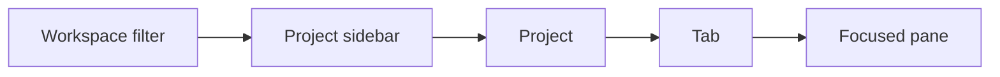
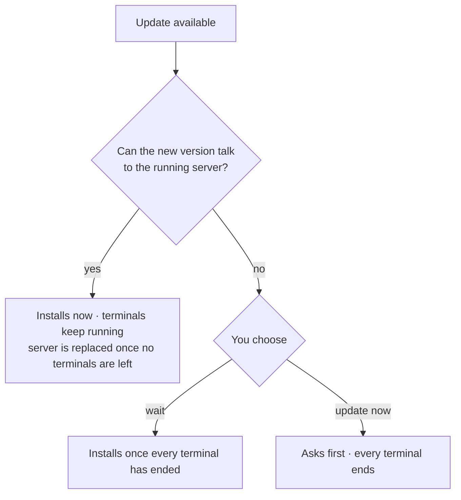

# App model

How people use Muxy: the apps, navigation, settings, and updates.

## The apps

| App | Connects to |
| --- | --- |
| Desktop app (macOS) | The server on the same computer, starting it if needed, and the servers of other computers over SSH or after pairing with them. |
| `muxy` terminal UI | The server on the same computer, starting it if needed, or with `--host`, the server on another computer over SSH. Ships with the desktop app and also on its own. |
| Phone app | A paired computer's server, over the local network or a VPN, or any computer's server over SSH. |

Every project knows which server it lives on. The desktop app works with one
**default server** at a time: this computer's until you pick another in the
status bar's server popover, or with **Use as Default Server** in a server's
menu. The sidebar lists only its projects, Home is its Home, and new projects
and tabs go to it. Each app keeps its choice, and forgetting that server goes
back to this computer's. Remote projects are marked with their server and
path where they show outside the sidebar.

Terminals another client shows on the default server, such as another
desktop, the terminal UI, or a phone, open here too, as tabs in their project
that don't take focus. So do the ones already showing elsewhere when you switch
to it. Terminals nobody shows, such as detached ones, stay in **Existing
Terminals**. Closing or detaching such a tab here leaves the terminal running
in the clients still showing it, and the app doesn't open it here again.

The **Servers** section at the bottom of the sidebar shows each remote server's
state and ticks the default one. Its popover adds servers (host, user, port,
key file, or a password that Muxy asks for and keeps only in memory) and
manages them. **Pair with Link…** adds another computer from the link its
**Settings → Servers** shows instead, with no SSH setup. A paired computer
can't be restarted from here, and pairing again from its **Edit…** form
recovers one that was revoked or reset. When a server lacks Muxy, a released
app offers to install the same version there; when its version can't talk to
the app, the section explains how to update it. Removing a server only forgets
its projects in this app.

**Manage Servers…** opens **Settings → Servers**, where everything about
servers and their clients lives:

- **This Mac** (**This Computer** on Linux) lets phones and other computers
  connect as clients: **Allow clients** turns access on, **Pair a client**
  shows a pairing code and link, and **Clients** lists the paired ones to
  revoke. A code that wasn't copied is withdrawn once the page leaves the
  screen; a copied link stays valid until it is used or expires. `muxy mobile`
  does the same without the desktop app.
- **Other Servers** lists every remote server by group, and connects,
  disconnects, regroups, or removes several at once. Disconnecting leaves a
  server's terminals running there.

**Add Project** (the row below the project list, or the sidebar's filter menu
in **Focus Current Project**) offers **Folder…** (⌘O) on the default server and
its **Recently Removed** projects. ⌘O searches folders that aren't projects yet and completes typed paths
with Tab; **Finder…** (**Browse…** on Linux) picks one in the system dialog
instead. Enter adds the folder as a project with a terminal, or opens a terminal
in the project it already is. Missing folders require an explicit creation
confirmation.

**New Tab in Project…** (⌘⇧N) lists the default server's saved projects, then
matching folders. Enter opens a terminal in the project, or at a folder in its
computer's Home; ⌘Enter adds the folder as a project with a terminal. With
another computer's server as the default, it browses that server's folders,
connecting first if needed. Clicking a server in the Servers popover offers
**New Tab** too, which makes it the default server first.

Files and images dropped or pasted on a remote terminal, or sent from the
composer, are copied to that computer and its path is pasted. Clicking a file
path in a remote terminal offers a read-only copy here, or its path.

Each app keeps its own layout: tabs, splits, workspaces, and project order.
Projects and terminals are shared, and the default server's terminals open as
tabs in every app that has it as its default. Several `muxy` windows can open the same
terminal UI layout.

## Navigation



- The sidebar shows **All projects** by default. Pick a workspace to filter it.
  Home stays first and worktrees appear under their parent.
- One project order applies under every filter.
- Picking a project shows its tabs.
- A window has one focused pane. Closing it moves focus to a neighbor. Closing a
  tab moves focus to the next tab, or the previous one. Closing something in the
  background never steals focus.

## Moving tabs and panes

Tabs and panes move anywhere on the same computer. Terminals keep running and
pages keep their state. A terminal moved to another project belongs to it on
the server too, so removing the old project no longer ends it. Servers too old
to do that refuse the move.

- Drag a tab from the tab bar or the tab sidebar onto another place in the
  tabs, onto a project, or out of the app into a window of its own.
- Drag a pane by its header, or with Command held, into another tab's splits,
  onto the tab bar or a sidebar row as a new tab, onto a project, or out of the
  app into a window of its own.
- While dragging, a chip follows the pointer, the drop place is outlined or
  marked between tabs, and a place on another computer shows as refused.
- A tab in its own window has the system's window controls and leaves the main
  window's tabs. Drag its titlebar over the main window to put it back, or use
  **Move to Main Window**. Closing the window closes the tab. Tab windows reopen
  where they were after a restart.
- The pane header of a tab window is its titlebar: it holds the window's
  controls and moves the window. A tab window shows a titlebar of its own only
  when no pane header runs along its top.
- The tab menu offers **Move to New Window** and **Move to Project**; the pane
  menu adds **Move to New Tab** and, in a tab window, **Move to Main Window**.
  The command palette has **Move Tab to New Window**, **Move Pane to New Tab**,
  and **Move Pane to New Window** for the main window.
- A terminal still starting can't change project until it has started.

On Linux, panes and tabs move between windows through these menus, and a drag
out of the main window opens a window of its own. Only macOS follows a drag
from one window into another, since Linux doesn't tell apps where their
windows are on screen.

## Opening and restoring

- The desktop app restores all projects, tabs, and window state on launch. It
  never opens a tab by itself. Until the [welcome tour](#welcome-tour) is finished
  or skipped, it opens over them.
- The terminal UI opens one shell in Home the first time, then restores its
  layout.
- `muxy <folder>`, or on macOS dropping a folder on the Dock icon or using
  **Open With**, opens the folder in the desktop app. It makes this computer's
  server the default, selects the folder's project or adds one, then opens a
  new terminal tab there. Without the desktop
  app, or over SSH, `muxy <folder>` opens in the terminal UI.
- **Existing Terminals** lists a project's terminals that this app isn't
  showing, and which app owns each one. Opening one adds it to your layout.
  On the default server, the ones other clients show open as tabs by
  themselves, so it lists the detached ones and those closed here.

## Welcome tour

On launch, a short tour opens until it has been finished or skipped, on new and
existing installs alike. Its nine steps cover how the server and apps fit
together, projects, extensions, AI agents, the composer, remote servers, the
phone app, and shortcuts.

- **Skip Tour** or Escape ends it on any step. Clicking outside does not, and
  quitting partway shows it again from the start on the next launch.
- It sets things up only when asked. **Add a Project…** and **Add a Server…**
  open the usual dialogs, and the tour returns when they close. **Install &
  Enable** installs and enables the ticked extensions, Files and Git by default,
  after listing what each one asks for. They finish even if the tour closes first.
- **Pair a Phone** turns on **Allow clients** if it is off and shows a
  pairing code in the tour. Leaving the step withdraws the code, and turns access
  back off if the tour turned it on and nothing paired.
- Dragging the dimmed area, the art, or the tour's top bar moves the window.
- **Welcome Tour** at the top of Settings, or **Show Welcome Tour** in the command
  palette, replays it.

Each profile remembers this as `onboarding_completed` under `[appearance]` in
`settings.toml`.

## Worktrees

New Worktree has a name, a new or existing branch, and Default, Template, or
Folder location choices. Worktrees default to `~/.muxy/worktrees/<project>/<name>`.
Settings → General sets the global location; each project remembers its choice. Templates support `{branch}`, `{base-dir}`, and `{project-name}`.

Optional setup and teardown commands come from the source project's
`.muxy/worktree.json` and `$XDG_CONFIG_HOME/muxy/worktree.json` (by default,
`~/.config/muxy/worktree.json`):

```json
{ "setup": ["npm ci"], "teardown": ["docker compose down"] }
```

Review and enable commands when creating or removing a worktree; `muxy worktree`
runs them only with `--hooks`. Setup runs per-machine commands first; teardown
runs project commands first. Commands run in the worktree, with
`MUXY_PROJECT_PATH` and `MUXY_WORKTREE_ID`, `MUXY_WORKTREE_PATH`,
`MUXY_WORKTREE_NAME`, and `MUXY_WORKTREE_BRANCH` available.
A setup failure keeps the new worktree; a teardown failure stops removal.

## When things go away

| Situation | What you see |
| --- | --- |
| The server is offline | Projects stay visible, terminals keep their last screen, and web panes keep working. Edits and closes are replayed on reconnect. |
| A remote server drops | Its section shows it offline and it reconnects on its own, waiting longer each time, until a login or host key needs you. Its projects never show as failed while offline. |
| A project's folder is gone | The project shows as failed, also on a remote server. |
| A terminal ends | Its panes close in every app, including hidden tabs. |
| You quit or detach | Terminals keep running. On macOS, only while Muxy is on under Background App Activity; otherwise macOS ends them and the next launch shows how to turn it on. |
| **End All Sessions and Quit** | Every terminal on this computer ends and its panes close. Other panes stay. |

The status bar shows the default server. Its popover switches the app to
another server, and connects, restarts, or stops the one shown.

## Proxy

The status bar's **Proxy** popover sets up one HTTP or SOCKS5 proxy, with an
optional login, kept privately and left out of backups. **Use for the whole app**
sends new terminals on this computer, Muxy's own downloads, and SSH to remote
servers through it. Otherwise, right-click a terminal and choose **Apply
Proxy**: it restarts in the same folder with the proxy, and its tab shows a
proxy icon. Terminals get the proxy as `http_proxy`, `https_proxy`,
`all_proxy`, and `no_proxy`. Running terminals keep what they started with.

## Settings

- Settings opens in a single tab, on the default server. Opening it again selects the
  existing tab. It works while offline, and changes apply immediately.
- App preferences live in `settings.toml`, terminal preferences in
  `terminal.toml`, and custom themes in `themes/`.
- Every app shortcut can be changed in Settings → Keyboard. Terminal key
  bindings are set in Settings → Terminal, and the Quick Terminal
  shortcut has its own setting. Normal keystrokes in a terminal always go to
  the terminal.
- **Settings → Appearance → App language** picks the interface language. English
  is built in; other languages come from language-pack extensions, the same ones
  made for Muxy 1.x. Untranslated text stays English, and while the chosen pack is
  unavailable Muxy shows English.
- Server settings, such as the shell and history size, apply to this
  computer's server. `muxy --host` changes another computer's. Stopping or
  restarting it asks first.
- **Settings → Backup & Restore** exports settings, themes, extension preferences,
  projects, and layouts. Restore applies on the next launch and keeps a recovery
  copy in `Backups`. Existing projects are kept; matching projects receive the
  saved layouts. Server settings take effect after restarting the server.
- Import supported 1.x settings and local projects from the installed app, a
  `.muxy` backup, or `settings.json`. Unsupported options are listed before import.
  A 1.x import adds to what is already there: existing projects, tabs, and
  workspaces are kept. A profile with no projects or workspaces yet imports the
  installed 1.x automatically, once, including its extensions. Profiles chosen
  with `MUXY_DIR` are left alone.
  Config files open in the system editor. Backups exclude live terminal sessions,
  paired-device credentials, extension packages, and project files. They keep
  the list of remote servers but not remote projects, which come back from
  their server.

## Updates



When the new version can talk to the running server, checking **Also restart
the server** in the update dialog replaces the server now too. Every terminal
ends.

## Desktop features

- **Composer.** Write a draft, with files or images, and send it to the active
  terminal or to every visible split. Each project keeps its own
  draft, and a failed send keeps it.
- **Web views.** Extension pages as tabs, docked panels, popovers, or dialogs.
  They stay alive while hidden. Extension panels belong to a project: switching
  projects closes them, and switching back reopens them.
- **Extensions.** Add tabs, panels, a sidebar, toolbar and status bar items,
  shortcuts, and background scripts. They are managed in Settings → Extensions,
  declare their permissions, and ask before sensitive actions. A coding agent
  can [build, change, and publish them](../extensions/agents.md). Most extensions
  made for Muxy 1.x work unchanged; see the
  [compatibility limits](../extensions/get-started.md#coming-from-1x).
- **Git and AI.** For Git projects, the footer shows the branch and changes,
  commits and pushes with an AI-written message, and creates or manages pull
  requests. It uses an AI command-line tool you already have, chosen in
  Settings → AI.
- **Open in IDE.** A titlebar button opens a project on this computer in the
  file manager or an installed editor. Picking an app from its menu opens the project there
  and makes it the button's default.
- **Tips.** A tip appears from time to time as a toast in the window's
  bottom-right corner, and **Show Muxy Tip** in the command palette shows one on
  demand. Turn tips off from the toast or in Settings → Appearance.

## AI agents

The server recognizes AI coding agents running in terminals and whether each
one is working, waiting for you, or done.

- Tabs, worktrees, and projects show the state of their agents, and "waiting
  for you" comes first.
- The desktop app notifies you about agents in the background. Looking at the
  terminal clears the alert in every app.
- Detached terminals show no alerts, and no notification history is kept.

## Accessibility

Screen readers and automation tools can find and operate Muxy's controls:
projects, worktrees, tabs, panes, menus, forms and dialogs. Terminal contents
aren't exposed yet.
