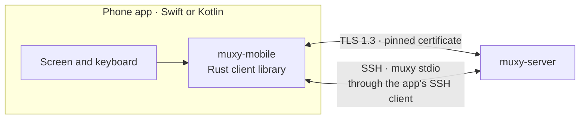
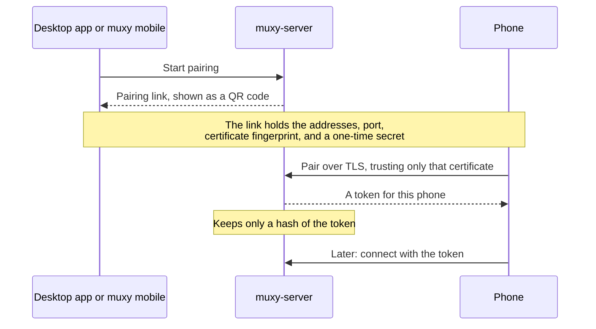
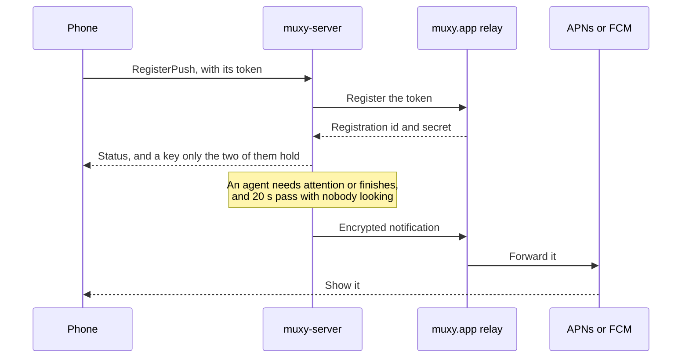

# Mobile

Phones connect straight to `muxy-server` on the user's computer. The only
service in between is the push relay at `muxy.app`, which forwards
[push notifications](#push-notifications) it can't read. A phone connects in
one of two ways:

- **Paired, over TLS.** The phone reaches the computer on the same network,
  through a VPN such as Tailscale, or at an address added to the pairing code.
- **Over SSH**, with the phone app's own SSH client. It runs `muxy stdio` on
  the computer, like `muxy --host` does, so no pairing or open port is needed.

## Pairing

The computer lists its own addresses. One that phones reach by another name,
such as a cloud server behind NAT, puts that name first with
`muxy mobile pair --address`.

## Security

- Mobile access is off until the user turns it on.
- The phone trusts only the certificate named in the pairing code, so another
  machine can't pretend to be the computer.
- Each phone has its own token and can be revoked at any time. Revoking closes
  its connection at once.
- A connection that hasn't signed in gets nothing else from the server.
- Paired phones can't manage mobile access, change server settings, stop the
  server, or run programs outside a terminal (`exec`). They can register only
  their own push token.
- Over SSH, the phone logs in as the user and can do what that login can. Host
  keys and credentials stay in the app's SSH client.

## The SDK

- `muxy-mobile` wraps the shared Rust client with UniFFI, which generates Swift
  and Kotlin bindings. Phones use the same protocol and flow control as the
  desktop app.
- The SDK keeps each attached screen up to date. The app draws it and sends
  input.
- Each release publishes the SDK for iOS and Android next to the desktop app.
  `scripts/build-mobile-sdk.sh` builds it locally.
- A phone works with any server that shares its protocol version, so phone
  releases only need to follow breaking protocol changes.

## Push notifications

- `muxy-server` sends them, with or without the desktop app. The relay holds
  the Apple and Google credentials, which can't ship in an open-source binary.
- Each paired phone that turns notifications on gets its own registration and
  32-byte key on each server. `remote.json` keeps the relay registration's id
  and secret, the key, and the phone's token.
- The content is end-to-end encrypted with AES-256-GCM. The relay sees only
  the kind of event, and identifiers derived from the key that mean nothing
  to it. The phone shows decrypted text only when it authenticates under a
  key it holds.
- An event is sent about 20 seconds after it happens, once per phone, unless
  it was acknowledged by then, the phone is connected, or push notifications
  or client access are off.
- Tapping one opens the app on the event's terminal pane.
- Only paired phones can register; phones over SSH have no device record.
- The server reaches the relay over HTTPS with the web PKI's roots, through
  the proxy in `HTTPS_PROXY`, `ALL_PROXY`, or `HTTP_PROXY` unless `NO_PROXY`
  says otherwise. `MUXY_PUSH_RELAY` points it at another relay, such as one on
  this computer for testing.
- `muxy mobile push off`, or the desktop's **Push notifications** setting,
  turns them off for every phone and deletes every registration.

The full contract between the server, the relay, and the apps is
[push-notifications.md](https://github.com/muxy-app/muxy.app/blob/main/docs/push-notifications.md)
in the `muxy.app` repository.

## Other computers

A desktop app pairs with another computer the same way, from the pasted link,
and reaches it like any remote server. It pairs as a computer, so the server
gives it a desktop's rights: it may also run programs (`exec`), change server
settings, and stop the server. Managing access stays with the computer itself.
Its token is kept in `paired-servers.toml`, which only the user can read and
backups leave out. Servers that predate this lack the `PAIRED_COMPUTERS`
feature, and the app refuses to pair with them rather than pair as a phone.

The full integration guide, with the API, setup, and error handling, is in
[`crates/muxy-mobile/README.md`](../../crates/muxy-mobile/README.md).
